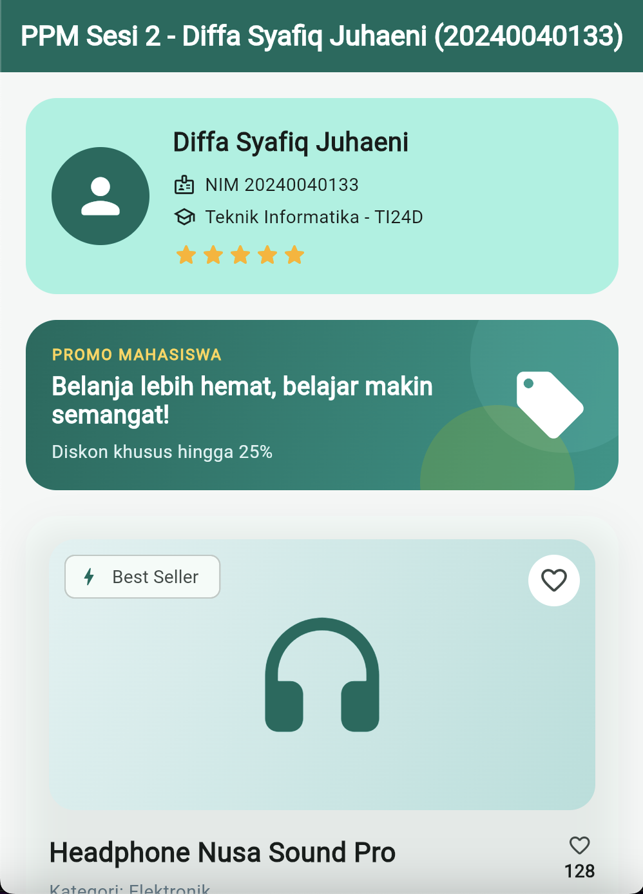
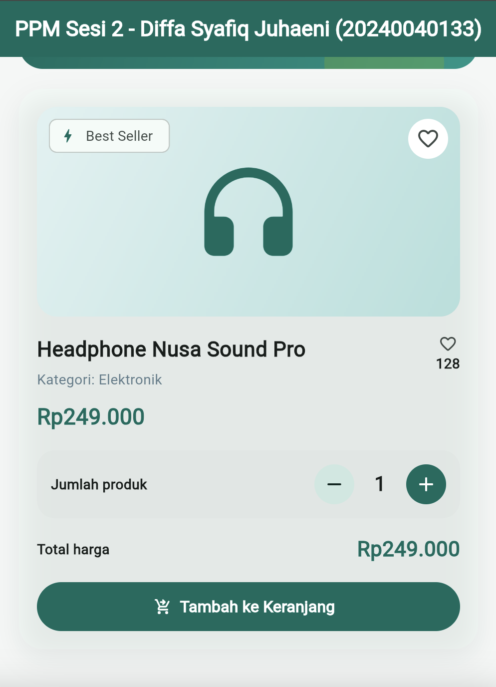
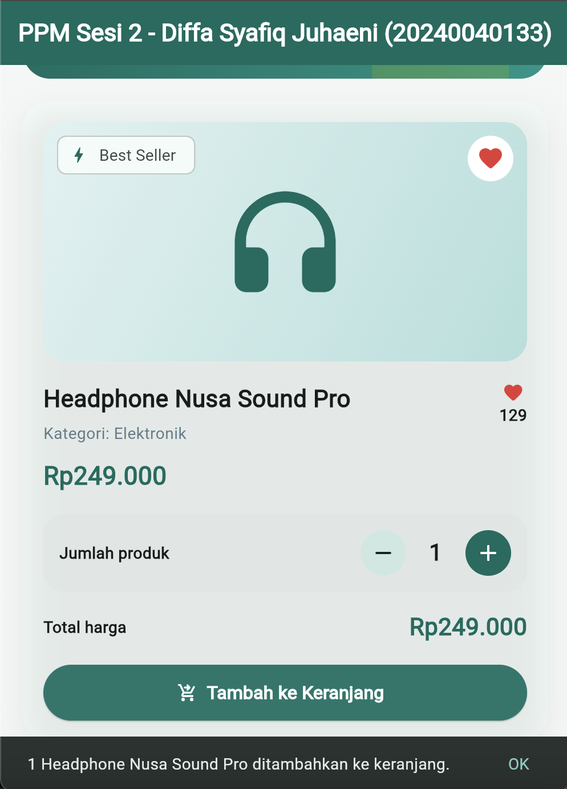
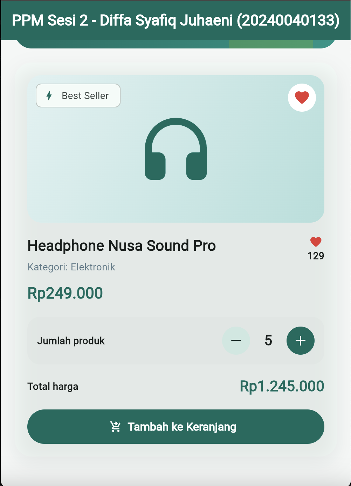
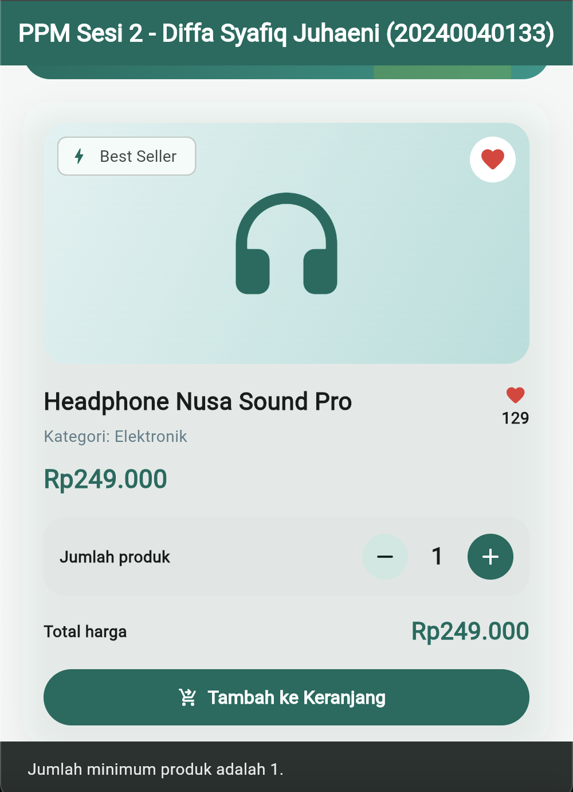

# PPM Sesi 2 Product dan Profile

Project tugas individu mata kuliah Pemrograman Perangkat Mobile Sesi 2 mengenai dasar Flutter dan widget. Aplikasi menampilkan profil mahasiswa, banner promo, dan kartu produk interaktif.

## Identitas

- Nama: Diffa Syafiq Juhaeni
- NIM: 20240040133
- Program Studi: Teknik Informatika
- Kelas: TI24D

## Fitur aplikasi

- Kartu profil mahasiswa menggunakan `StatelessWidget`.
- Identitas mahasiswa, ikon profil, dan lima ikon bintang.
- Banner promo menggunakan `Stack` dan `Positioned`.
- Kartu produk menggunakan `StatefulWidget`.
- Tombol favorit dengan perubahan ikon hati dan jumlah like.
- Kontrol jumlah produk dengan nilai minimum satu.
- Perhitungan total harga secara otomatis.
- Tombol Tambah ke Keranjang dengan notifikasi `SnackBar`.
- Tampilan responsif menggunakan Material 3.

## Widget yang digunakan

`Scaffold`, `Row`, `Column`, `Container`, `Card`, `Stack`, `Positioned`, `Icon`, `IconButton`, `FilledButton`, `StatelessWidget`, dan `StatefulWidget`.

## Screenshot hasil aplikasi

### 1. Tampilan profil dan banner promo



### 2. Informasi produk dan kontrol jumlah



### 3. Favorite aktif dan notifikasi keranjang



### 4. Perubahan jumlah dan total harga

Jumlah produk berubah menjadi 5 dan total harga otomatis menjadi Rp1.245.000.



### 5. Batas minimum jumlah produk

Saat tombol kurang ditekan pada jumlah 1, aplikasi mempertahankan nilai minimum dan menampilkan peringatan.



## Menjalankan project

```bash
flutter pub get
flutter run
```

## Pemeriksaan kode

```bash
flutter analyze
flutter test
```

Project telah disusun agar seluruh tombol dan perubahan state dapat diuji secara langsung.
